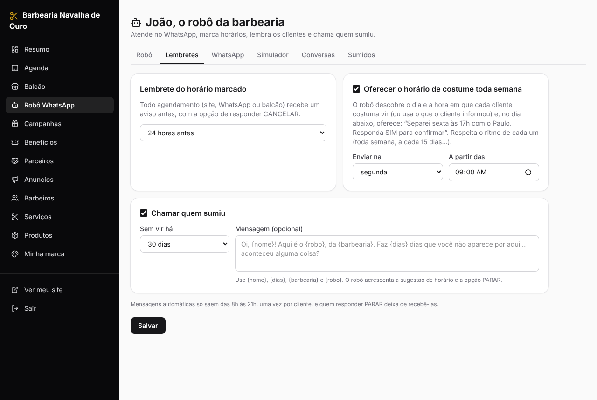
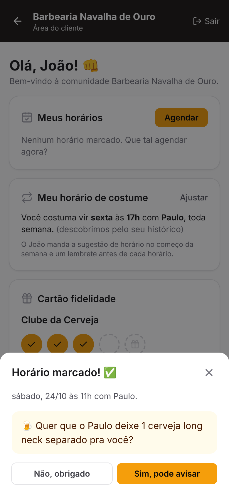
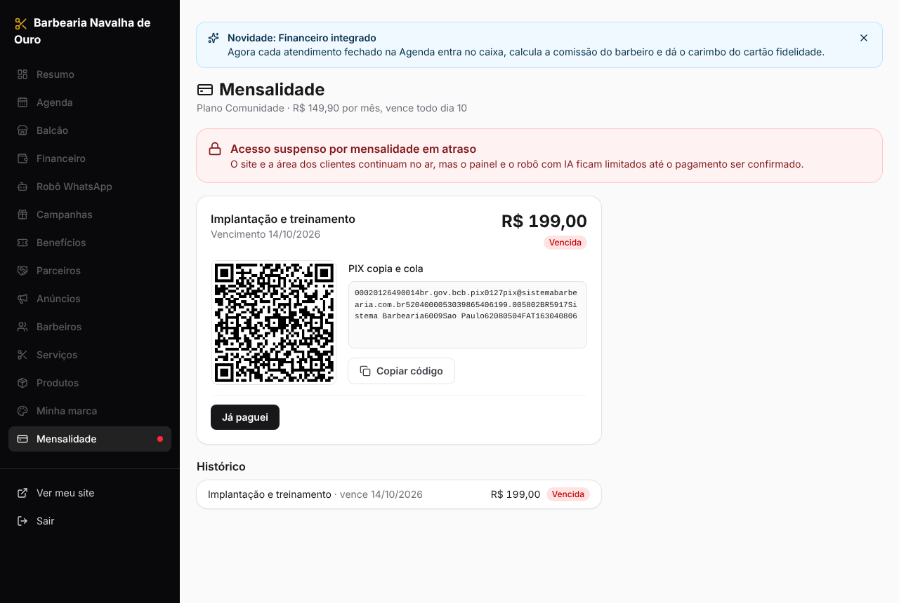

# Sistema Barbearia

Plataforma **white-label** para barbearias: o sistema é um só, e cada barbearia ganha o **próprio
site com a sua marca** (logo, cores, fotos, contatos), um **robô no WhatsApp com o nome que ela
escolher** e um **painel só dela**.

A ideia: o cliente não vive só o corte, vive uma **experiência de comunidade**: campanhas de
fidelidade, benefícios com voucher, comércios parceiros e um robô que lembra dele.

| Área do cliente (celular) | Robô no WhatsApp (simulador do painel) |
|---|---|
|  |  |

| Agenda | Lembretes e recontato | Painel master |
|---|---|---|
|  |  |  |

| Financeiro da barbearia | Fechar atendimento | O robô lembra da cerveja |
|---|---|---|
|  |  |  |

| Mensalidade (barbearia em atraso) | Mensalidades no master |
|---|---|
|  |  |

## Três áreas logadas

- **Master** (dono da plataforma), em três abas:
  - *Barbearias*: cria a barbearia e **libera o acesso** (login do dono, plano, valor, dia de
    vencimento e dias grátis; no fim aparece a mensagem pronta com o link e a senha para mandar
    pelo WhatsApp), troca senha, suspende e **entra no painel de qualquer barbearia** para operar
    como o dono (com uma faixa avisando).
  - *Financeiro*: as **mensalidades** das barbearias (veja abaixo), planos, chave PIX e regras.
  - *Sistema*: versão, servidor, banco, automações, falhas de envio do WhatsApp e **avisos de
    atualização** que aparecem no topo do painel de todas as barbearias.
- **Dono da barbearia**: agenda, barbeiros, **financeiro**, robô, marca, catálogo, campanhas,
  benefícios, parceiros, anúncios, clientes e a própria **mensalidade**. Nunca vê dados de outra
  barbearia.
- **Cliente** (`/b/<endereço>/conta`): entra pelo celular com um **código enviado pelo robô no
  WhatsApp** (ou pelo link que o robô manda) e fica logado por 180 dias. Só interage com o que é
  dele e o beneficia: agenda e cancela horários, vê o cartão fidelidade, pega vouchers, informa o
  horário de costume e vê **as próprias compras**. Nunca vê caixa, comissões ou outros clientes
  (o robô também não fala disso).

## O robô do WhatsApp

Cada barbearia dá um **nome** ao robô (aba *Robô WhatsApp*) e ele se apresenta assim. O cliente
conversa naturalmente:

- *"João, quantas cervejas faltam pro meu prêmio?"* → consulta o cartão fidelidade.
- *"João, olha na agenda do Paulo se tem vaga sexta às 19h"* → mostra os horários livres do Paulo
  (nunca quem marcou) e marca se o cliente pedir.
- *"Cancela meu horário"*, *"me manda o link da minha área"*, *"quero o voucher da cerveja"*,
  *"costumo vir às sextas, 7 da noite"* → cancela, manda o link, gera o voucher, salva o costume.
- Número desconhecido → pergunta o nome e cadastra.

**Ele aprende o consumo de cada cliente.** Se o João toma 1 cerveja em pelo menos metade das
visitas, ao confirmar o horário (pelo robô, pelo site ou no lembrete) vem a pergunta: *"Posso
avisar o Paulo que você vai querer 1 cerveja long neck hoje, pra ele deixar separado? 🍺"*. Com
SIM, o barbeiro recebe o aviso no WhatsApp (se tiver celular cadastrado), a agenda mostra
**🍺 Separar: 1 cerveja long neck** e, ao fechar o atendimento, a cerveja já entra na comanda.

Por baixo, o robô usa o **Claude** (Anthropic) com ferramentas que só enxergam a barbearia e o
celular da conversa. Respostas certeiras não passam pela IA: **SIM/NÃO** para um horário oferecido,
**CANCELAR** (desmarca o próximo horário), **PARAR/VOLTAR** (desliga/religa as mensagens
automáticas). **Sem chave da Anthropic**, o robô responde por menu (CARTÃO, HORÁRIOS, CANCELAR).

Canais (um por barbearia):

| Canal | Quando usar |
|---|---|
| **Simulador** | Padrão. Nada sai pelo WhatsApp; as conversas ficam no painel. Ótimo para testar e apresentar. |
| **Evolution API** | Conecta o WhatsApp da barbearia por QR Code (serviço próprio ou contratado). Mais simples de começar; não é a API oficial. |
| **WhatsApp oficial (Meta)** | Cloud API do WhatsApp Business. Exige conta verificada. Mensagens automáticas fora da janela de 24h só saem com um **modelo aprovado** pela Meta (configure o nome do modelo, com uma variável `{{1}}`). |

O painel mostra a URL do webhook de cada barbearia (com um segredo próprio) para colar na Meta ou
na Evolution, e tem um botão de **envio de teste**.

## Lembretes e recontato (automáticos)

- **Lembrete do horário**: todo agendamento (site, WhatsApp ou balcão) recebe um aviso X horas
  antes (padrão 24h), com a opção de responder CANCELAR.
- **Horário de costume**: o sistema **descobre pelo histórico** o dia, a hora, o barbeiro e o ritmo
  de cada cliente (ex.: sextas às 17h com o Paulo, toda semana) — ou usa o que o cliente informou.
  No dia escolhido (padrão: segunda às 9h), o robô oferece: *"Separei sexta, 31/10 às 17h com o
  Paulo. Responda SIM para confirmar"*. Se o horário estiver ocupado, oferece o mais próximo.
  Respeita o ritmo de cada um (quem vem a cada 15 dias não recebe toda semana) — ideal para planos
  mensais.
- **Cliente sumido**: quem não vem há N dias (padrão 30) recebe *"Faz 35 dias que você não
  aparece... aconteceu alguma coisa?"*, com sugestão de horário. Uma vez por ausência; a aba
  *Sumidos* lista todos e permite chamar na hora.

Regras: só das 8h às 21h, cada mensagem uma única vez, e quem responde PARAR deixa de receber as
automáticas (o lembrete do horário marcado continua).

## Financeiro da barbearia

Tudo ligado: o atendimento fechado na agenda vira dinheiro no caixa, comissão do barbeiro e
carimbo no cartão fidelidade, de uma vez.

- **Fechar atendimento** (botão *Fechar* na agenda): a comanda já vem com o serviço e o que o
  cliente pediu para separar; dá para somar produtos, mudar quem atendeu, dar desconto e escolher
  a forma de pagamento (PIX, dinheiro, débito, crédito). Vendas sem horário marcado saem pelo
  *Financeiro → Vendas* ou pelo *Balcão*.
- **Caixa**: entradas e saídas do período, saldo, lançamentos manuais (aluguel, luz, compras de
  produtos...) e **contas a pagar** com vencimento. As vendas, as comissões pagas e a mensalidade
  do sistema entram sozinhas.
- **Comissões**: cada barbeiro tem % nos serviços, % na venda de produtos e, se quiser, regras por
  serviço (ex.: corte R$ 25,00 fixo, barba 60%). A comissão é calculada **sobre o valor com
  desconto**. Em *Comissões* aparece quanto cada um tem a receber, o extrato e o botão *Pagar
  comissão*, que vira uma saída no caixa.
- **Resumo**: faturamento, gastos, resultado, ticket médio, contas a pagar, gráfico de entradas e
  saídas por dia, faturamento e comissão por barbeiro, formas de pagamento, mais vendidos e gastos
  por categoria.
- **Carimbo automático**: na campanha, escolha o produto ou serviço que dá carimbo (ex.: a cerveja
  no *Clube da Cerveja*). Fechou a venda, o carimbo entra no cartão do cliente. Cancelar a venda
  desfaz caixa, comissão e carimbo (se a comissão ainda não foi paga).

## Mensalidades da plataforma

- O master define **planos** (ou um valor próprio por barbearia), o **dia de vencimento** e os
  **dias grátis** de teste. As faturas do mês são geradas sozinhas; dá para gerar na mão ou criar
  uma **cobrança avulsa** (ex.: implantação).
- A barbearia vê a fatura em *Mensalidade* com **QR Code PIX e copia e cola** (chave PIX do master,
  com o valor certo) e avisa no botão *Já paguei*. O master confere e clica em *Confirmar
  pagamento*; a mensalidade paga entra como saída no caixa da barbearia.
- **Carência** (padrão 5 dias depois do vencimento): o painel avisa antes. Passou disso, o acesso
  fica **suspenso**: o painel só abre a tela da mensalidade, o robô responde só pelo menu (sem IA)
  e as mensagens automáticas param. O **site e a área do cliente continuam no ar**.
- O master pode **liberar o acesso até uma data** (ex.: prometeu pagar sexta) ou **suspender** a
  barbearia de vez.

## Tudo o que já funciona

| Módulo | O que faz |
|---|---|
| **Site da barbearia** (`/b/<endereço>`) | Mesmo modelo para todas, com a marca de cada uma: serviços, produtos, campanhas, parceiros, anúncios, botões de agendar e de falar com o robô. |
| **Agenda** | Coluna por barbeiro, horários do dia, encaixe pelo balcão, cancelar, marcar falta e **fechar o atendimento** (venda). Mostra o que separar para cada cliente. |
| **Barbeiros** | Expediente por dia da semana (com pausa), folgas, bloqueios, comissão e celular (para os avisos do robô). |
| **Financeiro** | Resumo, caixa, contas a pagar, vendas e comissões. |
| **Mensalidade** | Fatura da plataforma com PIX, histórico e situação do acesso. |
| **Robô WhatsApp** | Nome, jeito de falar, intervalo da agenda, lembretes, conexão com o WhatsApp, simulador, conversas e clientes sumidos. |
| **Área do cliente** | Login por código no WhatsApp, agendamento (com a pergunta do consumo de costume), cancelamento, cartão fidelidade, vouchers, compras, histórico e horário de costume. |
| **Benefícios** | Descontos e brindes com quantidade, limite por cliente e validade. O cliente pega o voucher (código único) e o balcão dá baixa. |
| **Campanhas de fidelidade** | "Junte N, ganhe 1": *tomou 5 cervejas, ganhou um copo*. |
| **Balcão** | Lança consumo, registra venda, entrega prêmios, valida vouchers, mostra o costume e os próximos horários do cliente e gera o link de acesso dele. |
| **Parceiros e anúncios** | Comércios do bairro com benefício para membros; espaço de propaganda vendido no site com visualizações e cliques. |
| **Resumo** | Horários do dia e da semana, marcações feitas pelo robô, mensagens, carimbos, prêmios, anúncios. |

## Rodar no computador

Requer **Node 22.13+**.

```bash
npm install
npm run demo   # opcional: cria a "Barbearia Navalha de Ouro" (robô João) com dados de exemplo
npm run dev    # interface em http://localhost:5173 (API na porta 3000)
```

- Primeiro acesso em `http://localhost:5173`: crie o login **master**.
- Demonstração: site em `/b/demo`; painel do dono `demo@barbearia.com` / `demo12345`; área do
  cliente em `/b/demo/conta` com o celular `(11) 99999-0000` (sem WhatsApp conectado, o código
  aparece na tela em desenvolvimento). A demo já tem vendas, despesas, comissões (Paulo: 40% nos
  serviços, barba R$ 15,00 fixo, 10% nos produtos), o plano *Comunidade* e o João, que toma uma
  cerveja toda sexta: marque um horário para ele e veja a pergunta da cerveja.
- Para o robô conversar com IA: `ANTHROPIC_API_KEY=... npm run dev`. Teste pela aba
  *Robô WhatsApp → Simulador*.

Outros comandos: `npm test` (agenda, costume, automações, robô, webhooks, área do cliente,
vouchers, financeiro, comissões, consumo, mensalidades e bloqueio, PIX, isolamento entre
barbearias), `npm run typecheck`, `npm run build && npm start`.

## Hospedar

```bash
cp .env.example .env      # ajuste PUBLIC_URL, DOMAIN e ANTHROPIC_API_KEY
docker compose --profile https up -d --build
```

O banco (SQLite) e as imagens ficam no volume `app-data` (`/data`). As automações rodam dentro do
próprio servidor, a cada minuto. O `PUBLIC_URL` precisa ser o endereço público com HTTPS: é dele que
saem as URLs de webhook e os links da área do cliente.

**Custo da IA:** cada mensagem respondida pelo robô consome tokens da Anthropic (o painel master
mostra o consumo por barbearia nos últimos 30 dias). O padrão é o modelo mais capaz
(`claude-opus-5-5`) com esforço baixo; dá para trocar com `BOT_MODEL` e `BOT_EFFORT`. As
respostas SIM/NÃO/CANCELAR/PARAR e todas as mensagens automáticas não usam IA.

## Como o código está organizado

```
server/
  db.ts             tabelas e migrações (SQLite nativo do Node)
  scheduling.ts     horários livres, marcação sem conflito, cancelamento
  habits.ts         descobre o horário de costume e o ritmo de cada cliente
  automations.ts    lembrete, oferta semanal e recontato (roda a cada minuto)
  bot/              robô: tools.ts (ferramentas), brain.ts (Claude), inbound.ts (respostas rápidas e menu)
  whatsapp.ts       Meta Cloud API e Evolution API (envio, webhooks, assinatura)
  messaging.ts      envio + histórico de mensagens
  customerAuth.ts   login do cliente (código de 6 dígitos e link de acesso)
  offers.ts         benefícios e vouchers
  loyalty.ts        cartão fidelidade
  finance.ts        vendas, caixa, comissões, pagamentos aos barbeiros e relatórios
  consumption.ts    consumo de costume do cliente e itens separados para o horário
  billing.ts        mensalidades: faturas, carência, bloqueio e liberação
  pix.ts            PIX copia e cola (BR Code com CRC)
  routes/           master, painel (shop, agenda, bot, finance), cliente, público, webhooks
web/src/
  pages/ShopLanding.tsx   site da barbearia
  pages/CustomerArea.tsx  área do cliente
  pages/Panel.tsx         painel do dono (pages/panel/*: Finance, Subscription, Agenda...)
  components/Checkout.tsx fechar atendimento / nova venda
  pages/Master.tsx        painel master
```

## Próximos passos sugeridos

1. **Confirmação automática do PIX** da mensalidade por um gateway (Asaas, Mercado Pago, Efí): hoje
   o master confere e confirma.
2. **Planos de assinatura para o cliente final** (ex.: cortes ilimitados) com cobrança recorrente.
3. **Estoque de produtos** com baixa automática na venda e aviso de reposição.
4. **Login de barbeiro** (cada um vê a própria agenda e as próprias comissões).
5. **Níveis da comunidade** (Bronze, Prata, Ouro), **domínio próprio por barbearia** e relatório de
   anúncios para o parceiro.
