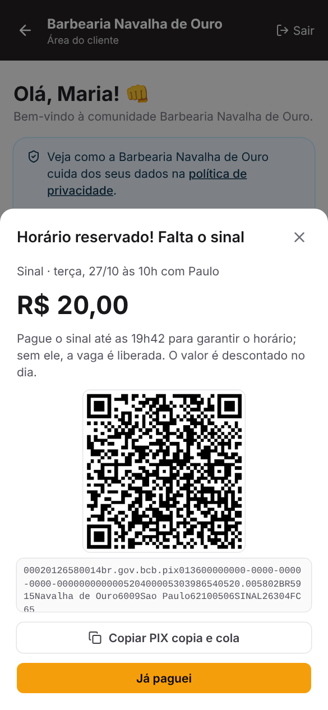

# Sistema Barbearia

Plataforma **white-label** para barbearias: o sistema é um só, e cada barbearia ganha o **próprio
site com a sua marca** (logo, cores, fotos, contatos), um **robô no WhatsApp com o nome que ela
escolher** e um **painel só dela**.

A ideia: o cliente não vive só o corte, vive uma **experiência de comunidade**: campanhas de
fidelidade, benefícios com voucher, clube de assinatura, indicação de amigos, presente de
aniversário, comércios parceiros e um robô que lembra dele (até da cerveja de sempre).

| Área do cliente (celular) | Robô no WhatsApp (simulador do painel) |
|---|---|
|  |  |

| Primeiros passos | Agenda | Fechar atendimento |
|---|---|---|
|  |  |  |

| Clube de assinatura | Avaliações | Indicação e aniversário |
|---|---|---|
|  |  |  |

| Sinal via PIX (cliente) | App do barbeiro | Financeiro | Estoque |
|---|---|---|---|
|  |  |  |  |

| Painel master | Pronto para o piloto? | Mensalidades no master |
|---|---|---|
|  |  |  |

## Quatro perfis

- **Master** (dono da plataforma) cuida **só do controle geral**: cria a barbearia e entrega o
  acesso ao dono (plano, valor, dia de vencimento, dias grátis e a mensagem pronta com o link e a
  senha), troca a senha e o celular do dono, suspende ou reativa, acompanha as **mensalidades**,
  configura o **Asaas**, o **WhatsApp da plataforma**, os **termos e a política de privacidade**,
  as **cópias de segurança** e os **avisos** que aparecem no painel de todas as barbearias. A aba
  *Sistema* tem o checklist **"Pronto para o piloto?"**. O master **não vê** agenda, barbeiros,
  clientes nem conversas (são da barbearia): a API recusa o master em qualquer rota do painel.
- **Dono da barbearia**: agenda, balcão, financeiro, estoque, robô, avaliações, clube de
  assinatura, campanhas, benefícios, indicação e aniversário, parceiros, anúncios, barbeiros,
  serviços, produtos, marca e a própria mensalidade. Nunca vê dados de outra barbearia.
- **Barbeiro** (o dono libera em *Barbeiros → Acesso ao sistema*): entra pelo **celular** ou
  e-mail e vê só a **própria agenda**, fecha os **próprios atendimentos** (se o dono permitir),
  marca falta e acompanha **Meus ganhos** (comissão a receber, extrato e pagamentos) e a nota que
  os clientes dão para ele. Não vê caixa, comissão dos colegas nem configurações.
- **Cliente** (`/b/<endereço>/conta`): entra pelo celular com um **código enviado pelo robô no
  WhatsApp** (ou pelo link que o robô manda) e fica logado por 180 dias. Agenda e cancela, paga o
  **sinal**, assina o **clube**, vê o cartão fidelidade, pega vouchers, manda o **link de
  indicação**, informa o **aniversário** e o horário de costume, vê as próprias compras, **baixa
  os próprios dados** e pode **excluir a conta** (LGPD).

Todos (menos o cliente) têm **Minha conta** (nome, celular, senha) e **"Esqueci minha senha"**
com código pelo WhatsApp da plataforma.

## O robô do WhatsApp

Cada barbearia dá um **nome** ao robô (aba *Robô WhatsApp*) e ele se apresenta assim. O cliente
conversa naturalmente:

- *"João, quantas cervejas faltam pro meu prêmio?"* → consulta o cartão fidelidade.
- *"João, olha na agenda do Paulo se tem vaga sexta às 19h"* → mostra os horários livres do Paulo
  (nunca quem marcou) e marca se o cliente pedir.
- *"Cancela meu horário"*, *"me manda o link da minha área"*, *"quero o voucher da cerveja"*,
  *"costumo vir às sextas, 7 da noite"*, *"meu aniversário é 12 de março"*, *"me passa meu link
  de indicação"* → faz na hora.
- Número desconhecido → pergunta o nome, cadastra (com o aviso da política de privacidade) e
  aceita o **código de quem indicou**.
- *"Paguei"* → avisa a barbearia do PIX do sinal ou da mensalidade do clube.

**Ele aprende o consumo de cada cliente.** Se o João toma 1 cerveja em pelo menos metade das
visitas, ao confirmar o horário vem a pergunta: *"Posso avisar o Paulo que você vai querer 1
cerveja long neck hoje, pra ele deixar separado? 🍺"*. Com SIM, o barbeiro recebe o aviso, a
agenda mostra **🍺 Separar** e, ao fechar o atendimento, a cerveja já entra na comanda. Produto
esgotado no estoque não é oferecido.

Por baixo, o robô usa o **Claude** (Anthropic) com ferramentas que só enxergam a barbearia e o
celular da conversa. Respostas certeiras não passam pela IA: **SIM/NÃO** para um horário oferecido,
**CANCELAR**, **PARAR/VOLTAR**, **PAGUEI** e a **nota de 1 a 5** da avaliação. **Sem chave da
Anthropic**, o robô responde por menu (CARTÃO, HORÁRIOS, CANCELAR).

Canais (um por barbearia):

| Canal | Quando usar |
|---|---|
| **Simulador** | Padrão. Nada sai pelo WhatsApp; as conversas ficam no painel. Ótimo para testar e apresentar. |
| **Evolution API** | Conecta o WhatsApp da barbearia por QR Code (serviço próprio ou contratado). Mais simples de começar; não é a API oficial. |
| **WhatsApp oficial (Meta)** | Cloud API do WhatsApp Business. Exige conta verificada. Fora da janela de 24h, só saem **modelos aprovados** pela Meta: o painel lista um modelo por tipo de mensagem (lembrete, costume, sumido, código, avaliação, aniversário, indicação, sinal, clube...) com o texto sugerido e as variáveis. |

O painel mostra a URL do webhook de cada barbearia (com um segredo próprio), tem **envio de
teste** e confere a **conexão a cada 10 minutos**: se o WhatsApp cair, o dono recebe um aviso
pelo WhatsApp da plataforma (e o painel mostra uma faixa vermelha).

## Mensagens automáticas

Só das 8h às 21h (no fuso de cada barbearia), cada uma uma única vez, e quem responde PARAR deixa
de receber as de marketing.

- **Lembrete do horário** X horas antes (padrão 24h), com a opção de responder CANCELAR.
- **Horário de costume**: o sistema descobre pelo histórico o dia, a hora, o barbeiro e o ritmo de
  cada cliente e, no dia escolhido (padrão: segunda às 9h), oferece o horário de sempre.
- **Cliente sumido** depois de N dias (padrão 30), com sugestão de horário.
- **Avaliação depois do corte** (padrão 2h depois; no máximo uma por cliente a cada 30 dias).
- **Presente de aniversário** no dia, com voucher.
- **Mensalidade do clube** 3 dias antes de vencer (com o PIX em mensagem separada, fácil de
  copiar) e um lembrete se atrasar.
- **Pedido do sinal** logo depois de marcar pelo site (com o PIX) e o aviso de **vaga liberada**
  quando o sinal não é pago no prazo (esses dois saem a qualquer hora: são resposta ao pedido do
  cliente).

## Agenda, sinal e barbeiros

- **Agenda** por barbeiro, encaixe pelo balcão, falta, cancelamento e **fechar o atendimento**.
- **Sinal via PIX** (botão *Sinal* na agenda): sem sinal, só de quem já faltou (últimos 6 meses)
  ou de todos que marcam pelo site/WhatsApp. O horário fica **segurado** esperando o PIX (QR Code
  e copia e cola direto na chave da barbearia); sem pagamento no prazo, a vaga é liberada sozinha.
  O sinal é **abatido no fechamento**. Cancelou com antecedência (ou a barbearia cancelou): vira
  **crédito** para o próximo horário (o dono pode devolver). Em cima da hora ou falta: fica com a
  barbearia. Assinantes do clube não pagam sinal.
- **Barbeiros**: expediente com pausas, folgas, bloqueios, comissão (por serviço, inclusive valor
  fixo) e acesso ao sistema.

## Clube de assinatura

O cliente paga um valor fixo por mês e usa os serviços do plano **sem pagar na hora**, até o
limite do mês (ou à vontade). Ele assina pela **área do cliente** (ou o dono adiciona no balcão)
e paga por **PIX direto na chave da barbearia**; avisa com *Já paguei* (ou *paguei* no WhatsApp)
e o dono confere no banco e confirma pelo aviso no topo do painel, e só então entra no caixa. Na
comanda, o que o plano cobre já sai por **R$ 0**, e a comissão do barbeiro é calculada sobre o
preço normal (na % que o dono escolher). Atrasou, os benefícios pausam até o pagamento. Os planos
aparecem no site da barbearia.

## Financeiro e estoque

- **Fechar atendimento**: a comanda já vem com o serviço, o que o cliente pediu para separar, o
  que o clube cobre e o sinal pago; dá para somar produtos, mudar quem atendeu, dar desconto e
  escolher a forma de pagamento.
- **Caixa** (entradas, saídas, contas a pagar), **comissões** (a receber, extrato e *Pagar
  comissão*), **resumo** com gráfico, faturamento por barbeiro, formas de pagamento e gastos.
- **Carimbo automático**: o produto ou serviço ligado a uma campanha vira carimbo no cartão.
- **Estoque**: entrada de mercadoria (com lançamento no caixa), contagem, perda, consumo interno,
  baixa automática na venda (volta no cancelamento), reservado para os horários marcados e aviso
  de **estoque acabando** no resumo.

## Avaliações, indicação e aniversário

- **Avaliações**: depois do atendimento o robô pede uma nota de 1 a 5. Nota 4 ou 5 recebe o
  **link para avaliar no Google**; nota baixa, o robô pergunta o que melhorar e o comentário chega
  no **WhatsApp do dono**. O painel mostra a média, a nota por barbeiro e os comentários (com
  botão para chamar o cliente).
- **Indique um amigo**: cada cliente tem um link; quem chega por ele vê *"Fulano te indicou"* e
  pode ganhar um presente de boas-vindas; quem indicou ganha o prêmio quando o amigo **vem pela
  primeira vez** (venda fechada) e recebe o código pelo WhatsApp.
- **Aniversário**: o cliente informa dia e mês; no dia, ganha o presente (29/02 cai em 28/02 nos
  outros anos).
- Os prêmios são **vouchers** (validados no Balcão como qualquer benefício), fora da lista de
  benefícios comuns.

## Mensalidades da plataforma

- O master define **planos** (ou um valor por barbearia), o **dia de vencimento** e os **dias
  grátis**. As faturas são geradas sozinhas; dá para criar uma **cobrança avulsa**.
- **Com o Asaas** (opcional, aba *Financeiro* do master): cada fatura vira uma cobrança PIX com
  QR Code próprio; quando o PIX cai, o Asaas avisa (webhook com token) e a fatura é **baixada
  sozinha**. Com a nota fiscal ligada, o Asaas emite a **NFS-e** de cada mensalidade paga (link no
  painel do dono e do master). O dono informa CPF/CNPJ e nome na tela *Mensalidade*.
- **Sem o Asaas**: PIX copia e cola com a chave do master e confirmação manual (*Já paguei* →
  *Confirmar pagamento*).
- **Lembrete** pelo WhatsApp da plataforma antes de vencer e depois de vencida.
- **Carência** (padrão 5 dias): passou disso, o painel só abre a tela da mensalidade, o robô
  responde só pelo menu e as automáticas param. O **site e a área do cliente continuam no ar**.
  O master pode **liberar até uma data** ou **suspender**.

## Privacidade (LGPD) e segurança

- Termos de uso, política de privacidade da plataforma e **política de cada barbearia**
  (publicada no site dela). A conta do cliente só nasce com o **aceite**; o dono aceita os termos
  no primeiro acesso.
- O cliente **baixa os próprios dados** e **exclui a conta**; o dono faz o mesmo pelo Balcão
  (as vendas ficam no caixa sem identificar a pessoa).
- Limpeza automática: mensagens com mais de 1 ano, códigos com mais de 30 dias, sessões vencidas.
- Cada barbearia só enxerga o que é dela; o barbeiro só o que é dele; o master só a plataforma.
- **Cópia de segurança** todo dia às 3h (guarda as últimas 14), com envio opcional para um
  armazenamento compatível com S3 (Cloudflare R2, Backblaze B2, AWS S3...) e criptografia
  opcional (AES-256-GCM).

## Antes da primeira barbearia de verdade (piloto)

O master tem o checklist **"Pronto para o piloto?"** na aba *Sistema*:

1. `PUBLIC_URL` com **https** (links da área do cliente, webhooks e login seguro).
2. `DEMO_LOGIN_CODES=0` (senão o código de acesso aparece na tela).
3. **Cópia de segurança fora do servidor** (`BACKUP_S3_...`) funcionando; recomendado
   `BACKUP_PASSWORD` (guarde a senha fora do servidor).
4. **WhatsApp da plataforma** conectado (senha esquecida, lembrete da mensalidade, alerta de
   WhatsApp desconectado) e o **seu celular** em *Minha conta*.
5. **Dados da empresa** nos termos e na política (nome, CNPJ, e-mail).
6. **Recebimento das mensalidades**: chave PIX ou Asaas.
7. Recomendado: `ANTHROPIC_API_KEY` para o robô conversar com IA.

Na barbearia, o resumo do painel mostra os **Primeiros passos** (marca, barbeiros, serviços,
WhatsApp conectado, celular do dono, primeiro cliente, primeiro atendimento fechado, chave PIX e
link do Google).

## Rodar no computador

Requer **Node 22.13+**.

```bash
npm install
npm run demo   # opcional: cria a "Barbearia Navalha de Ouro" (robô João) com dados de exemplo
npm run dev    # interface em http://localhost:5173 (API na porta 3000)
```

- Primeiro acesso em `http://localhost:5173`: crie o login **master**.
- Demonstração:
  - site em `/b/demo`;
  - painel do dono `demo@barbearia.com` / `demo12345`;
  - barbeiro Paulo `(11) 95555-4444` / `paulo1234`;
  - área do cliente em `/b/demo/conta` com o celular `(11) 99999-0000` (João). Sem WhatsApp
    conectado, o código aparece na tela em desenvolvimento.
  - A demo já tem vendas, despesas, comissões, estoque, um plano do clube (o Pedro é assinante),
    avaliações, uma indicação (o Pedro veio pelo João) e o aniversário do João chegando. O João
    toma uma cerveja toda sexta: marque um horário para ele e veja a pergunta da cerveja.
- Para o robô conversar com IA: `ANTHROPIC_API_KEY=... npm run dev`. Teste pela aba
  *Robô WhatsApp → Simulador*.

Outros comandos: `npm test` (agenda, costume, automações, robô, webhooks, área do cliente,
vouchers, financeiro, comissões, consumo, estoque, clube, sinal, avaliações, indicação,
aniversário, mensalidades, Asaas, LGPD, cópia de segurança, acesso do barbeiro, limites do master,
isolamento entre barbearias), `npm run typecheck`, `npm run build && npm start`.

## Hospedar

```bash
cp .env.example .env      # ajuste PUBLIC_URL, DOMAIN, ANTHROPIC_API_KEY e as cópias de segurança
docker compose --profile https up -d --build
```

O banco (SQLite) e as imagens ficam no volume `app-data` (`/data`). As automações rodam dentro do
próprio servidor, a cada minuto. Todas as variáveis estão comentadas no `.env.example`.

**Restaurar uma cópia de segurança** (com o sistema parado):

```bash
npm run restore -- barbearia-AAAA-MM-DD-HHMMSS.db.gz          # cópia local
npm run restore -- barbearia-AAAA-MM-DD-HHMMSS.db.gz.enc      # cópia criptografada (pede BACKUP_PASSWORD)
npm run restore -- <arquivo> --forcar                          # substitui o banco atual
```

**Custo da IA:** cada mensagem respondida pelo robô consome tokens da Anthropic (o master vê o
consumo por barbearia nos últimos 30 dias). O padrão é o `claude-opus-5-5` com esforço baixo; dá
para trocar com `BOT_MODEL` e `BOT_EFFORT`. As respostas rápidas (SIM/NÃO/CANCELAR/PARAR/PAGUEI,
nota da avaliação) e todas as mensagens automáticas não usam IA.

## Como o código está organizado

```
server/
  db.ts             tabelas e migrações (SQLite nativo do Node)
  clock.ts, time.ts relógio de cada barbearia (fuso) e datas
  scheduling.ts     horários livres, marcação sem conflito, cancelamento
  habits.ts         descobre o horário de costume e o ritmo de cada cliente
  automations.ts    tudo que roda sozinho (a cada minuto)
  bot/              robô: tools.ts (ferramentas), brain.ts (Claude), inbound.ts (respostas rápidas e menu)
  whatsapp.ts       Meta Cloud API e Evolution API (envio, webhooks, conexão)
  templates.ts      modelos da Meta por tipo de mensagem
  messaging.ts      envio + histórico; platform.ts: WhatsApp da plataforma
  connection.ts     confere a conexão do WhatsApp e avisa o dono
  finance.ts        vendas, caixa, comissões, pagamentos aos barbeiros e relatórios
  stock.ts          estoque; consumption.ts: consumo de costume e itens separados
  charges.ts        cobranças PIX da barbearia (clube e sinal) e confirmação
  club.ts           clube de assinatura; deposits.ts: sinal; reviews.ts: avaliações
  growth.ts         indique um amigo e aniversário; offers.ts: benefícios e vouchers
  billing.ts        mensalidades da plataforma; asaas.ts: Asaas; invoiceReminders.ts
  privacy.ts        LGPD; backup.ts: cópias de segurança; passwordReset.ts
  routes/           master, painel (shop, agenda, bot, finance, stock, club), barbeiro, cliente, público, webhooks
web/src/
  pages/ShopLanding.tsx   site da barbearia
  pages/CustomerArea.tsx  área do cliente (+ CustomerClub, CustomerDeposit, CustomerGrowth)
  pages/Panel.tsx         painel do dono (pages/panel/*)
  pages/BarberApp.tsx     app do barbeiro
  pages/Master.tsx        painel master (pages/master/*)
  components/Checkout.tsx fechar atendimento / nova venda
tools/                    seed-demo.ts (demonstração), restore-backup.ts (restaurar cópia)
```

## O que só dá para conferir com contas de verdade

Tudo acima tem teste automático e foi conferido no navegador com dados de demonstração. Ainda
precisam ser conferidos com as contas reais, no piloto: o envio pelo **WhatsApp oficial (Meta)**
e pela **Evolution** com os modelos aprovados, a **cobrança e a nota fiscal no Asaas** (testado
com um simulador da API), o envio da cópia de segurança para o seu **armazenamento S3** e o
**PIX** pago de verdade num aplicativo de banco.
